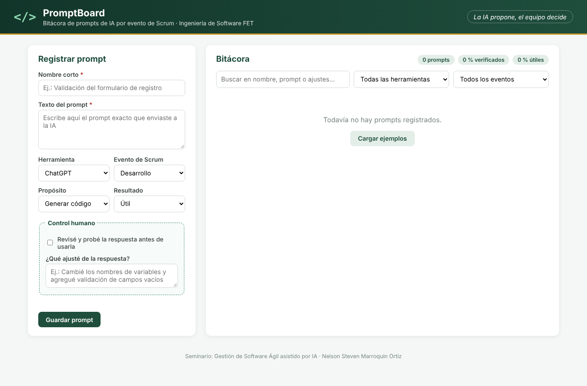
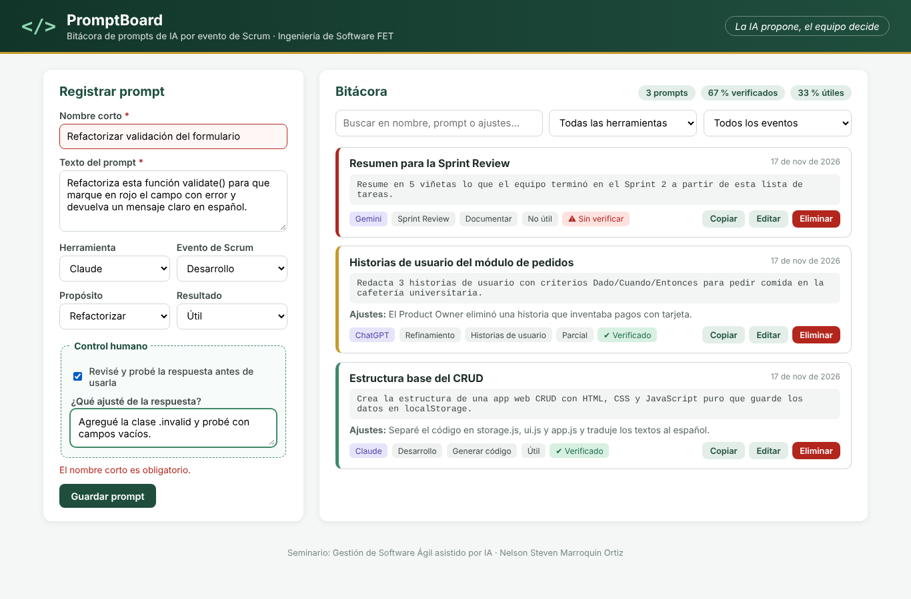
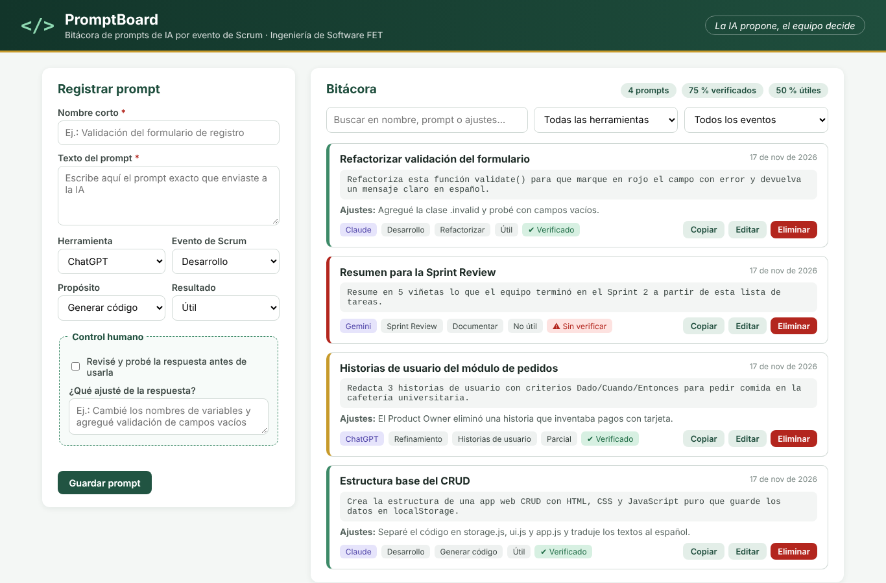
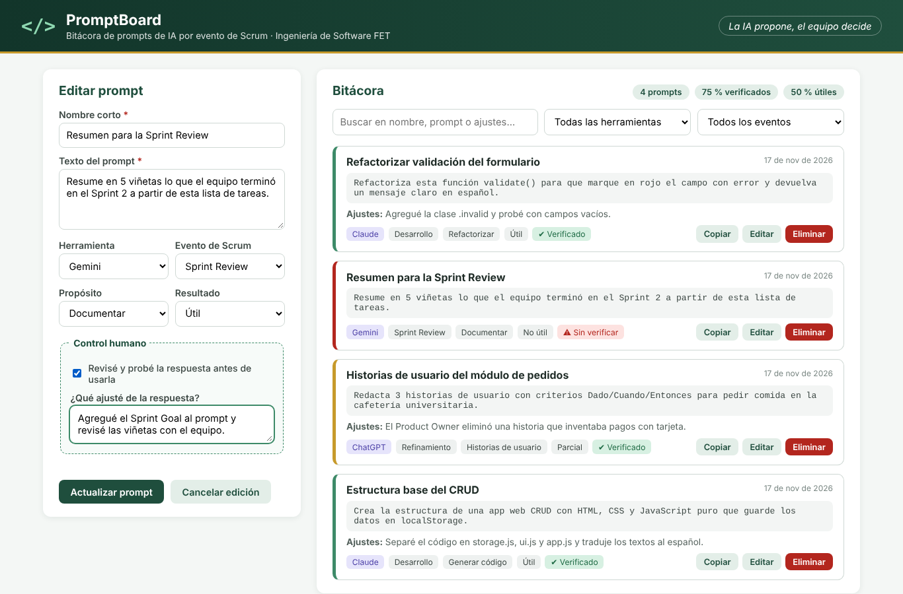
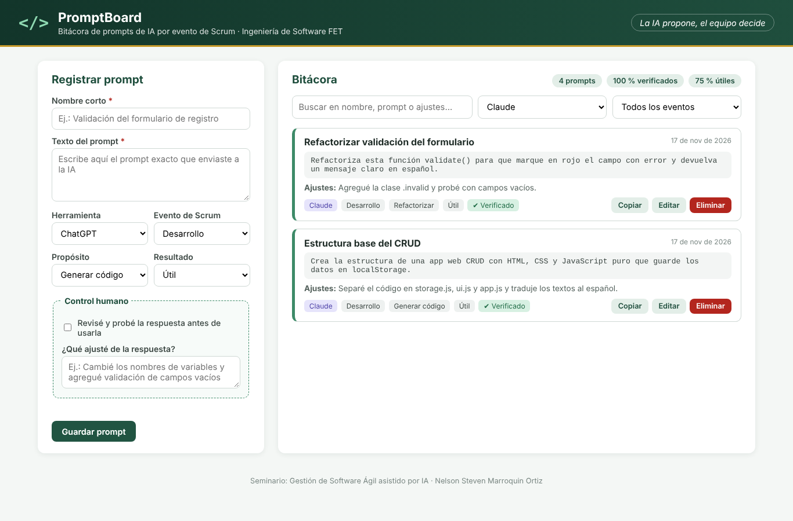
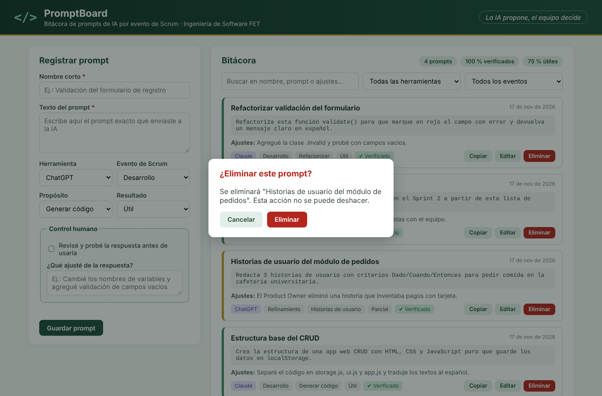
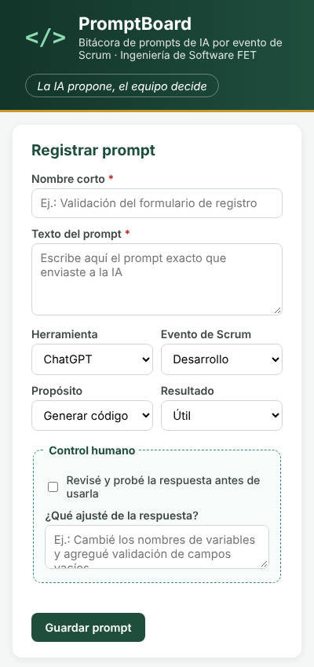

# PromptBoard · Bitácora de prompts para equipos ágiles

Aplicación web **CRUD** para registrar, consultar, editar y eliminar los prompts de IA que un equipo Scrum usa durante un proyecto. De cada prompt se guarda la herramienta, el evento de Scrum en el que se usó, el propósito, si sirvió y, sobre todo, **qué revisó y ajustó la persona** antes de aceptar la respuesta. Así, el uso de la IA queda documentado y es posible inspeccionarlo en la retrospectiva.

> Principio de diseño: **la IA propone, el equipo decide.**

Trabajo práctico del seminario *Gestión de Software Ágil asistido por Inteligencia Artificial*, programa de Ingeniería de Software, Fundación Escuela Tecnológica de Neiva Jesús Oviedo Pérez (FET).
**Autor:** Nelson Steven Marroquin Ortiz.

---

## Funcionalidades

| Operación | Qué hace en la app |
|---|---|
| **Create** | El formulario registra un prompt nuevo. Valida que el nombre y el texto no estén vacíos y asigna un id y una fecha automáticos. |
| **Read** | Muestra la bitácora en tarjetas, con búsqueda por texto, filtros por herramienta y por evento de Scrum, e indicadores (total, % verificados, % útiles). |
| **Update** | El botón **Editar** carga el prompt en el formulario, que cambia a modo edición; **Actualizar** guarda los cambios y **Cancelar edición** los descarta. |
| **Delete** | El botón **Eliminar** abre una ventana de confirmación propia; el registro solo se borra si se confirma (se puede cancelar con *Esc*). |

Extras: botón **Copiar** para reutilizar un prompt, botón **Cargar ejemplos** para la demostración, mensajes emergentes de confirmación, colores según el resultado (verde = útil, dorado = parcial, rojo = no útil), diseño adaptable a celular y protección contra inyección de HTML.

## Tecnologías utilizadas

- **HTML5**: estructura y formulario accesible (etiquetas `label`, `fieldset`, `role="dialog"`).
- **CSS3**: variables de color, Grid y Flexbox, diseño *responsive* y animaciones.
- **JavaScript (ES6+)**, sin frameworks: funciones flecha, *template literals*, `async/await`, delegación de eventos.
- **localStorage**: persistencia de datos en el navegador, sin servidor ni base de datos.
- **Herramientas de IA**: Claude (Anthropic) y ChatGPT (OpenAI) para generar y refactorizar el código.
- **Git y GitHub**: control de versiones y publicación.

## Estructura del proyecto

```
promptboard/
├── index.html          # Estructura: encabezado, formulario, listado y modal
├── css/
│   └── styles.css      # Estilos y diseño responsive
├── js/
│   ├── storage.js      # Capa de datos: CRUD sobre localStorage
│   ├── ui.js           # Capa de interfaz: pinta tarjetas, estadísticas, modal y toast
│   └── app.js          # Lógica: conecta formulario y botones con storage y ui
├── docs/capturas/      # Capturas de pantalla para este README
└── README.md
```

El código está separado en tres capas para que cada archivo tenga una sola responsabilidad. Por ejemplo, si después se quiere guardar en Firebase en lugar de localStorage, solo se cambia `storage.js`.

## Cómo ejecutar el proyecto

**Opción 1 (la más fácil):**
1. Descarga o clona el repositorio:
   ```bash
   git clone https://github.com/<tu-usuario>/promptboard.git
   ```
2. Abre `index.html` con doble clic en Chrome, Edge o Firefox. No necesita instalar nada.

**Opción 2 (con servidor local, recomendado para el botón Copiar):**
- En Visual Studio Code, instala la extensión **Live Server**, haz clic derecho sobre `index.html` y elige *Open with Live Server*.
- O, si tienes Python: `python -m http.server 8000` y abre `http://localhost:8000`.

**Versión en línea:** <!-- Pega aquí el enlace de GitHub Pages: https://<tu-usuario>.github.io/promptboard/ -->

> Los datos se guardan en el navegador (localStorage). Si se borran los datos del navegador o se abre en otro equipo, la bitácora empieza vacía.

## Capturas de pantalla

**Inicio (bitácora vacía)**


**Create: registrar un prompt**


**Read: listado con indicadores**


**Update: formulario en modo edición**


**Read: filtro por herramienta**


**Delete: confirmación antes de eliminar**


**Vista en celular**


## Prompts utilizados

El desarrollo se hizo de forma incremental. Cada prompt generó o mejoró una parte del código, y después de cada respuesta revisé, probé y ajusté el resultado.

### Prompt 1: Estructura base del CRUD
```
Actúa como desarrollador web. Crea una aplicación web CRUD llamada "PromptBoard" con
HTML, CSS y JavaScript puro, sin frameworks, que guarde los datos en localStorage.
Sirve para que un equipo Scrum registre los prompts de IA que usa. Cada registro tiene:
nombre corto, texto del prompt, herramienta (ChatGPT, Claude, GitHub Copilot, Gemini,
Cursor, Otra), evento de Scrum (Refinamiento, Sprint Planning, Desarrollo, Daily Scrum,
Sprint Review, Retrospective), propósito, resultado (Útil, Parcial, No útil), una
casilla "verificado" y un campo "qué ajusté". Todo el texto de la interfaz en español.
```
**Qué pedí y para qué:** la primera versión funcional de las cuatro operaciones. Definí el tema y los campos para que la IA no inventara un CRUD genérico de tareas.
**Qué ajusté:** cambié algunos nombres de campos y agregué el campo "qué ajusté", que la IA había omitido.

### Prompt 2: Refactorizar en archivos separados
```
Refactoriza el código anterior separándolo en tres archivos: storage.js (solo lectura y
escritura en localStorage, con funciones getAll, getById, create, update y remove),
ui.js (solo funciones que pintan en pantalla) y app.js (eventos y lógica). No uses
módulos ES6 (import/export) porque quiero abrir la app con doble clic sin servidor.
```
**Qué pedí y para qué:** ordenar el código por responsabilidades para que sea más fácil de entender y mantener (organización del código).
**Qué ajusté:** verifiqué que el orden de los `<script>` en `index.html` fuera storage → ui → app.

### Prompt 3: Validación del formulario
```
Agrega validación al formulario: el nombre corto es obligatorio y el texto del prompt
debe tener al menos 10 caracteres. Muestra el mensaje de error debajo del formulario y
marca en rojo el campo con error, sin usar alert().
```
**Qué pedí y para qué:** evitar registros vacíos o incompletos.
**Qué ajusté:** cambié los textos de error y probé enviando el formulario vacío.

### Prompt 4: Editar con el mismo formulario
```
Implementa la edición: al pulsar "Editar" en una tarjeta, carga sus datos en el mismo
formulario, cambia el título a "Editar prompt" y el botón a "Actualizar prompt", y
muestra un botón "Cancelar edición". Usa un input oculto con el id para saber si se
crea o se actualiza.
```
**Qué pedí y para qué:** reutilizar un solo formulario para Create y Update.
**Qué ajusté:** agregué que, al eliminar un prompt que se estaba editando, el formulario se reinicie (la IA no contempló ese caso).

### Prompt 5: Confirmación al eliminar
```
Reemplaza el confirm() del navegador por una ventana modal propia con los botones
Cancelar y Eliminar. Hazla con una promesa (Promise) para poder usar await, y que se
cierre también con la tecla Esc.
```
**Qué pedí y para qué:** prevenir borrados accidentales con una confirmación más clara y con mejor estilo.
**Qué ajusté:** puse el nombre del prompt dentro del mensaje de confirmación.

### Prompt 6: Búsqueda, filtros e indicadores
```
Agrega una barra de búsqueda que filtre por nombre, texto del prompt y ajustes, y dos
filtros desplegables por herramienta y por evento de Scrum. Arriba del listado muestra
tres indicadores: total de prompts, porcentaje verificados y porcentaje útiles.
```
**Qué pedí y para qué:** mejorar la operación Read y poder analizar el uso de la IA en la retrospectiva.
**Qué ajusté:** hice que el mensaje "Ningún prompt coincide con los filtros" sea distinto del de bitácora vacía.

### Prompt 7: Revisión de seguridad
```
Revisa el código y dime si hay riesgos de seguridad. Si un usuario escribe etiquetas
HTML en el prompt, ¿se ejecutarían? Corrígelo.
```
**Qué pedí y para qué:** detectar inyección de HTML (XSS), porque las tarjetas se pintan con `innerHTML`.
**Qué ajusté:** probé escribiendo ``. Con la función `escapeHTML` se muestra como texto y no se ejecuta.

### Prompt 8: Diseño y versión móvil
```
Mejora el diseño con una paleta verde institucional (#1f4e3d) y detalles dorados, en
tarjetas con sombra, y que el borde izquierdo de cada tarjeta cambie de color según el
resultado. En pantallas menores a 860 px, el formulario debe quedar arriba del listado.
```
**Qué pedí y para qué:** una interfaz clara y adaptable a celular, con los colores de la FET.
**Qué ajusté:** ajusté el ancho de los filtros porque el texto "Todas las herramientas" se cortaba.

### Prompt 9: Comentarios y documentación
```
Agrega comentarios breves en español que expliquen qué hace cada función y cada bloque
del CRUD, sin comentar lo obvio. Luego genera un README con descripción, tecnologías,
instrucciones de ejecución y la estructura de carpetas.
```
**Qué pedí y para qué:** dejar el código entendible y documentado.
**Qué ajusté:** revisé que cada comentario fuera correcto y redacté con mis palabras la explicación de cada prompt.

## Uso responsable de la IA

- Todo el código generado se leyó, se probó en el navegador y se ajustó antes de aceptarlo.
- Puedo explicar cada parte: `storage.js` maneja los datos, `ui.js` pinta la pantalla y `app.js` conecta los eventos con las operaciones CRUD.
- La propia app aplica la idea: un prompt no verificado aparece marcado con ⚠ hasta que alguien lo revisa.
